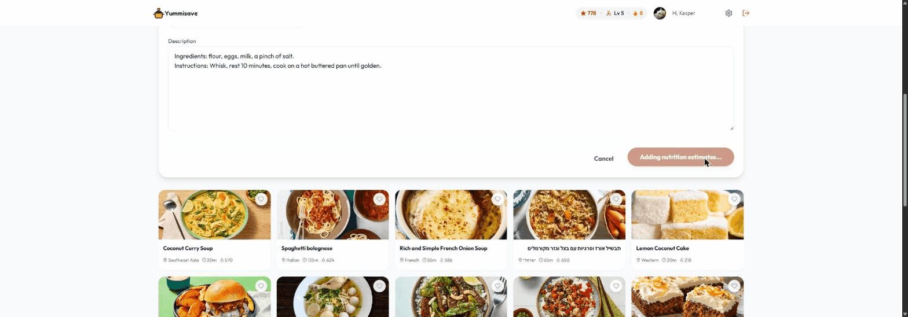

# Gamification Engine

A small, tested, **event-driven** engine for points, XP, levels, badges, streaks,
and progress trackers — the common engagement/retention primitives — packaged as a
reusable Claude Code **skill / plugin**.

The core has **no framework or database dependency**. Your app emits domain
events (`item.created`, `session.open`, …) and a data-only config decides the
rewards. Persistence lives behind a two-method storage adapter, so it runs on
Firestore, Postgres, MongoDB, DynamoDB, Prisma, Supabase, Redis, a REST API — or
an in-memory store for tests.

```
app action ──▶ engine.emit(userId, event) ──▶ { points, xp, badges, streak, … }
                        │
                        ▼
              StorageAdapter (atomic read-modify-write)
```

In action — saving a recipe fires a level-up toast, then the rewards panel shows
the new level, points, XP, streak, and a freshly unlocked badge (a real app built
with this engine):

<p align="center">
  
</p>

## Install (Claude Code)

This repo is its own plugin marketplace — add it, then install:

```
/plugin marketplace add kasperjunky/Gamification-Skill
/plugin install gamification-engine@gamification-skill
```

Claude Code will ask you to trust the source (it's third-party, not the official
Anthropic directory). You can also vendor it directly — copy `skills/gamification-engine/`
into your project's `.claude/skills/` (or `~/.claude/skills/` for all projects).

## Use in Cursor, Copilot, or any editor

The engine is **plain TypeScript with zero runtime dependencies**, so it works in any
project regardless of which AI editor you use — the Claude Code plugin is just one
delivery mechanism.

> **Note:** Cursor added a plugin system in 2.5, but it currently can't add a *custom*
> plugin marketplace, so the `/plugin marketplace add` command above is Claude-Code-only.
> In Cursor (or anywhere) use the engine as a library instead:

```bash
# add the engine to your project (git subtree keeps it updatable)
git subtree add --prefix src/gamification \
  https://github.com/kasperjunky/Gamification-Skill main --squash
# the library lives at: src/gamification/skills/gamification-engine/src
```

Or simply copy `skills/gamification-engine/src` into your project and import from it:

```ts
import { GamificationEngine, MemoryAdapter } from './gamification/src';
```

Point your editor's AI assistant at `skills/gamification-engine/SKILL.md` and the
`references/` folder and it has everything it needs to wire the engine into your app.

## Features

- **Points / XP / levels** from a configurable XP→level curve.
- **Badges** with nestable conditions (`counter`, `streak`, `tracker`, `grant`, `all`/`any`).
- **Daily streaks** with timezone-correct day bucketing and freeze-to-bridge support.
- **Progress trackers** (e.g. profile completion) with completion bonuses.
- **Idempotent** by design: `once` rules fire exactly once; an optional `eventId`
  makes *every* rule safe against retries and replayed offline queues.
- **Anti-abuse**: server-trusted time (no clock-spoofed streaks), per-rule
  `maxPerDay` rate limits, and `validateConfig()` that rejects broken configs at
  construction.

## Repository layout

This repo is a Claude Code plugin. The skill itself lives under
`skills/gamification-engine/` (its `SKILL.md`, `src/`, `references/`, `examples/`,
`test.ts`); `.claude-plugin/plugin.json` is the plugin manifest. Repo-level files
(README, LICENSE, CI, etc.) stay at the root.

## Quick start (contributors)

No install step and no `package.json` — run the tooling with `npx`:

```bash
# behavior spec
npx tsx skills/gamification-engine/test.ts
# typecheck
npx -p typescript -p @types/node tsc --noEmit -p tsconfig.json
```

Wire it into an app (paths relative to the skill folder, `skills/gamification-engine/`):

```ts
import { GamificationEngine, MemoryAdapter } from './src';
import { config } from './examples/config.example'; // or your own

const engine = new GamificationEngine(config, new MemoryAdapter());

const award = await engine.emit(userId, { type: 'item.created', subjectId: itemId });
if (award.badgesEarned.length) showBadgeToast(award.badgesEarned);
if (award.levelUp) showLevelUp(award.levelUp);
```

Run `engine.emit` in **trusted server code** (a Cloud Function / API route), never
in the browser, and keep the gamification record server-writable only.

## Storage adapters

Import paths are relative to the skill folder (`skills/gamification-engine/`):

| Adapter | Import | Use |
| --- | --- | --- |
| `MemoryAdapter` | `./src` | tests, local dev |
| `OptimisticAdapter` | `./src` | any store with a conditional write (SQL, Mongo, Dynamo, Prisma, Supabase, REST) |
| `FirestoreAdapter` | `./src/adapters/firestore` | client-side Firebase (modular SDK; `firebase` peer dep) |
| `AdminFirestoreAdapter` | `./src/adapters/firestore-admin` | **server-side** Firebase — Cloud Functions / Node (`firebase-admin` peer dep) |

Bringing your own database is ~20 lines — see
[writing-an-adapter.md](skills/gamification-engine/references/writing-an-adapter.md).

## Documentation

- [SKILL.md](skills/gamification-engine/SKILL.md) — the full skill guide (wiring, idempotency, streaks, security, ethics).
- [config-schema.md](skills/gamification-engine/references/config-schema.md) — every config field.
- [writing-an-adapter.md](skills/gamification-engine/references/writing-an-adapter.md) — put the engine on your database.
- [ui-integration.md](skills/gamification-engine/references/ui-integration.md) — front-end patterns (stat pill, rewards modal, badge metadata).
- [ethical-design.md](skills/gamification-engine/references/ethical-design.md) — dark-pattern checklist. **Read before shipping.**
- [config.example.ts](skills/gamification-engine/examples/config.example.ts) — a worked config covering all three feature areas.

## Packaging as a skill bundle

A `gamification-engine.skill` zip (the skill files under a `gamification-engine/`
folder) is attached to each [GitHub Release](https://github.com/kasperjunky/Gamification-Skill/releases)
as a convenience download. It is **not committed to the repo** (the plugin
directory only accepts text/JSON/YAML/image files). To build one yourself:

```bash
# bash (needs the `zip` CLI); writes to a temp dir, not the repo
mkdir -p /tmp/pkg/gamification-engine && cp -r skills/gamification-engine/. /tmp/pkg/gamification-engine/
(cd /tmp/pkg && zip -r - gamification-engine) > /tmp/gamification-engine.skill
```

## License

[MIT](LICENSE) © kasperjunky
